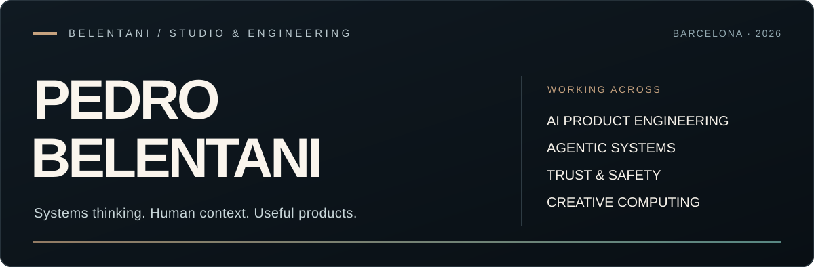

# Pedro Belentani

**Creative Technologist · Applied AI · Open education · Creative computing · Trust & Safety**

Brazilian perspective · Barcelona, Spain · English / Español / Português (BR)

[Professional portfolio](https://pedro-belentani-portfolio.honeybrook4.chatgpt.site) · [Artist universe](https://belentani.es) · [Software atlas](https://github.com/belentani7/belentani-omg-portal) · [Selected work](#selected-work) · [Evidence](#engineering-evidence) · [Contact](#contact)

<!-- insignias: generado 2026-11-06 -->

  
  
  
  
  
  
  

## What I build

I am a **Creative Technologist** working at the intersection of **full-stack engineering, applied artificial intelligence, accessible education and creative direction**. I make advanced technology easier to understand and use by connecting product research, interfaces, typed APIs, AI-agent workflows, privacy, testing and the actual needs of the people using the software.

My path runs through multilingual customer operations and Trust & Safety into product engineering, open learning and audiovisual art. My approach: **understand the problem, choose a proportionate architecture, build useful interactions and make limitations visible.** Technical breadth supports delivery; it does not replace real verification.

[Read my personal story and five working principles (Spanish)](https://pedro-belentani-portfolio.honeybrook4.chatgpt.site/sobre-mi.html) · [Ten-point working manifesto](https://pedro-belentani-portfolio.honeybrook4.chatgpt.site/metodo.html#manifiesto).

## Selected work

Six **public, accessible source repositories**, selected to represent distinct capabilities. A public repository is not automatically a live or production-ready service.

| Project | Focus and currently documented boundary |
| --- | --- |
| [Manos Abiertas](https://github.com/belentani7/ManosAbiertas) | Free multilingual digital education: AI, office skills, CV resources, accessible course activities and learner progress. **Public code; publication pending per project README.** |
| [Belentani CV Studio](https://github.com/belentani7/Belentani.cv-ai) | Next.js/React CV editing, letters, local drafts and optional AI-assisted workflows with privacy controls. **Deployment and complete user flows require verification.** |
| [Secure-T](https://github.com/belentani7/secure-t) | Open cybersecurity and applied-AI campus, assessments and simulated workstation. **Educational software, not a certified security service.** |
| [LinguaForge](https://github.com/belentani7/linguaforge) | Language-learning paths, spaced repetition, exercises and traceable content provenance. **The learning corpus is expanding.** |
| [Belentani — Artist Experience](https://github.com/belentani7/belentani.es) | Interactive music and narrative universe built around Three.js and creative direction. **Source is public; live deployment status is separate.** |
| [Belentani Software Atlas](https://github.com/belentani7/belentani-omg-portal) | Searchable index connecting a wider software ecosystem. **Catalogue inventory is a snapshot and may lag behind GitHub.** |

Other projects are private, archived or experimental. I do not present inaccessible repositories as public deliverables, or repository volume as a measure of quality.

## Capabilities

| Discipline | Technologies and focus |
| --- | --- |
| **Product engineering** | TypeScript, React, Next.js, Vite, Node.js, Python, FastAPI, APIs, data models, Git and deployment workflows |
| **Applied AI** | Tool-using agents, orchestration, human review, input validation, model integration, cost-aware automation and guardrails |
| **Experience design** | Responsive interfaces, accessibility, multilingual content, product narrative and browser interaction |
| **Trust & Safety** | Context-sensitive analysis, privacy, abuse prevention, policy interpretation and risk escalation |
| **Creative technology** | Three.js, graphics, music and audiovisual workflows, storytelling and interactive systems |

AI-assisted development is part of the workflow. **Commit volume does not substitute for code review, passing tests or a functioning user journey.**

## Experience behind the code

My engineering perspective also comes from multilingual professional operations and content-policy work:

- **2016–2018:** multilingual customer support, including Sellbytel / Inditex-related work.
- **2018–2025:** community and content moderation, including TELUS / CCC-related work, with human judgment and policy interpretation.
- **2026:** independent software, educational, AI and creative projects; public source histories document iterations, not verified client outcomes.

I combine **systems thinking, human context and creative direction** to make complex tools easier to understand and use.

## Engineering evidence

[Engineering evidence — reviewed GitHub activity (29 October 2026)](./docs/engineering-evidence-2026-10-29.md) records a bounded sample, dates, methods and explicit limitations. GitHub contribution events **cannot** measure human work hours, product adoption, production uptime or the quality of each repository. Historical figures are point-in-time records, not performance scores.

For technical details, inspect a project's current README, source history, tests and documented release boundaries.

## Tools and experiments

The [Living Machine](./docs/living-machine/index.html) and [browser-based Production Studio](./docs/living-machine/studio.html) contain inspectable source for local-first media, document and creative utilities. These links open **repository files**, not a verified live deployment. Browser-specific features still need direct testing.

The [previous extended profile](./docs/profile-archive-2026-10-29.md) is preserved for historical context, not for current availability claims.

## GitHub en números

  
  

  

  

  
  
  

## Contact

Open to thoughtful technical collaboration, open-source dialogue and creative partnerships.

[Portfolio / artist universe](https://belentani.es) · [Email](mailto:belentani7pedro@gmail.com) · [GitHub](https://github.com/belentani7)

Clarity, accessibility, traceable evidence and useful products over exaggerated claims.
