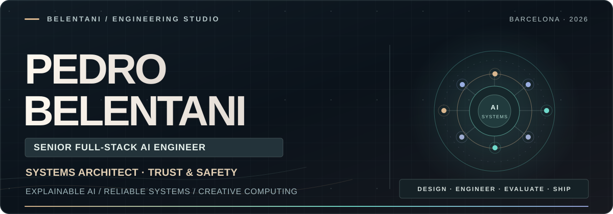
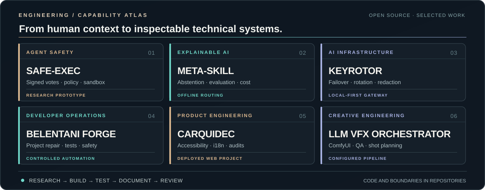

 

# Pedro Belentani

### Senior Full-Stack AI Engineer & Systems Architect

**Agentic Systems · Explainable AI · Trust & Safety · Creative Technology**

*Engineering with evidence. Intelligence with human context. Creativity with purpose.*

**Barcelona, Spain** · English / Español / Português (BR) / Català

[**Professional Portfolio**](https://pedro-belentani-portfolio.honeybrook4.chatgpt.site) · [**LinkedIn**](https://linkedin.com/in/pedro-b-09473598) · [**Creative Universe**](https://belentani.es) · [**Technical Evidence**](./docs/engineering-evidence-2026-10-29.md) · [**Contact**](#contact)

---

## The intersection I work in

I build **AI infrastructure, explainable agent workflows, security-conscious developer tools, accessible digital products and immersive creative experiences**.

My background includes **multilingual Trust & Safety operations (2018–2025)**, where policy interpretation, ambiguity, escalation, risk and human judgment are everyday realities. I bring that context to applied AI engineering: define the boundary, test the edge case, make failure visible and keep a human in control.

**I work across the full chain:** product discovery → architecture → implementation → evaluation → delivery → improvement.

## Selected systems

These six public source repositories represent complementary engineering disciplines. Explore the actual source, tests and implementation boundaries rather than using commit totals as a quality score.

<table>
<tr>
<td width="50%" valign="top">
<h3><a href="https://github.com/belentani7/safe-exec">01 / SAFE-EXEC</a></h3>

<strong>Agent safety · Signed pre-execution decisions</strong>

A research prototype for checking exact file bytes before proposed isolated execution, with policy checks, independent signed evaluations, replay protection and one-use release tokens.

<a href="https://github.com/belentani7/safe-exec/blob/main/tests/test_protocol.py">Signed-protocol tests</a> · <a href="https://github.com/belentani7/safe-exec">Source</a>

<strong>Boundary:</strong> External sandbox / Docker integration remains unverified end-to-end; the current CI does not yet run the full test suite.

</td>
<td width="50%" valign="top">
<h3><a href="https://github.com/belentani7/meta-skill">02 / META-SKILL</a></h3>

<strong>Explainable AI · Routing and evaluation</strong>

Offline heuristic task routing with abstention, model-tier suggestions, budget-aware reporting and a reproducible evaluation harness.

<a href="https://github.com/belentani7/meta-skill/blob/main/evaluation-lab/evaluate.py">Evaluation implementation</a> · <a href="https://github.com/belentani7/meta-skill">Source</a>

<strong>Boundary:</strong> Synthetic fixtures validate mechanics, not production accuracy or measured savings.

</td>
</tr>
<tr>
<td width="50%" valign="top">
<h3><a href="https://github.com/belentani7/keyrotor">03 / KEYROTOR</a></h3>

<strong>LLM infrastructure · Reliability patterns</strong>

A local-first multi-provider LLM gateway with key rotation, retries, circuit breakers, TTL caching, provider failover and secret redaction.

<a href="https://github.com/belentani7/keyrotor/blob/main/tests/test_router.py">Transport regression tests</a> · <a href="https://github.com/belentani7/keyrotor">Source</a>

<strong>Boundary:</strong> Local development scope; public deployment requires additional access controls and hardening.

</td>
<td width="50%" valign="top">
<h3><a href="https://github.com/belentani7/belentani-forge">04 / BELENTANI FORGE</a></h3>

<strong>Developer automation · Quality operations</strong>

A Python project engine for inventory, diagnostics, verification, controlled repairs and cross-repository reporting.

<a href="https://github.com/belentani7/belentani-forge/blob/main/tests/test_safety.py">Safety tests</a> · <a href="https://github.com/belentani7/belentani-forge">Source</a>

<strong>Boundary:</strong> Read-only by default; potentially destructive actions require deliberate authorization.

</td>
</tr>
<tr>
<td width="50%" valign="top">
<h3><a href="https://github.com/belentani7/CARQUIDEC">05 / CARQUIDEC</a></h3>

<strong>Product engineering · Accessibility and performance</strong>

A multilingual, progressively enhanced website with responsive media, self-hosted assets, automated accessibility and quality checks.

<a href="https://github.com/belentani7/CARQUIDEC/blob/main/AUDITORIA.md">Before-and-after audit</a> · <a href="https://github.com/belentani7/CARQUIDEC">Source</a>

<strong>Boundary:</strong> Repository reports document improvements; external browser validation remains a separate check.

</td>
<td width="50%" valign="top">
<h3><a href="https://github.com/belentani7/llm-vfx-orchestrator">06 / LLM VFX ORCHESTRATOR</a></h3>

<strong>Creative AI · Reproducible production workflows</strong>

A local-first shot planner and Python orchestration CLI for configurable LLM planning, ComfyUI rendering, QA and bounded retries.

<a href="https://github.com/belentani7/llm-vfx-orchestrator/blob/main/.github/workflows/ci.yml">Python and web CI</a> · <a href="https://github.com/belentani7/llm-vfx-orchestrator">Source</a>

<strong>Boundary:</strong> Browser planning is offline; complete rendering requires external services and configuration.

</td>
</tr>
</table>

## Products built for people

Technical ambition matters most when it reaches a person, a team or a real workflow.

| Education & accessibility | Creative technology & audiovisual work |
|:---|:---|
| **[Manos Abiertas](https://github.com/belentani7/ManosAbiertas)** — free multilingual digital learning, practical AI, office skills and CV resources. Its documented build generates **832 lesson pages** in four language editions. The latest referenced release is not confirmed publicly available. | **[HEYDUCK](https://github.com/belentani7/heyduck)** — interactive music-production portfolio with Web Audio utilities, animations and multilingual experience. [Project-listed deployment](https://heyduck.vercel.app/). |
| **Human context:** accessible pathways, progressive learning, transparent content provenance and privacy-aware design. | **[Belentani — The Experience](https://github.com/belentani7/belentani.es)** — a Three.js music and narrative universe that combines audiovisual authorship with interactive engineering. [Artist universe](https://belentani.es). |

## Engineering evidence — not just claims

| Practice | What you can inspect |
|:---|:---|
| **Evaluation & restraint** | [Meta-Skill's abstention tests](https://github.com/belentani7/meta-skill/blob/main/tests/test_router.py) and [metrics implementation](https://github.com/belentani7/meta-skill/blob/main/evaluation-lab/evaluate.py) |
| **Security by design** | [SAFE-EXEC's signed-protocol tests](https://github.com/belentani7/safe-exec/blob/main/tests/test_protocol.py) and [Forge's safety layer](https://github.com/belentani7/belentani-forge/blob/main/forge/safety.py) |
| **Repeatable delivery** | [CARQUIDEC's quality gates](https://github.com/belentani7/CARQUIDEC/blob/main/.github/workflows/ci.yml) and [VFX's dual-stack CI](https://github.com/belentani7/llm-vfx-orchestrator/blob/main/.github/workflows/ci.yml) |
| **Documented trade-offs** | [Engineering evidence — reviewed sample, 29 Oct 2026](./docs/engineering-evidence-2026-10-29.md) |

> **Operating principle:** A repository is not a product launch. A synthetic test is not a production benchmark. An automated commit is not a verified user outcome. GitHub activity cannot prove product uptime or adoption. Real engineering makes those distinctions legible.

<strong>Technical breadth — explore my working domains</strong>

 

| Domain | Languages, frameworks and practices |
|:---|:---|
| **Systems & backend** | Python · TypeScript · Node.js · FastAPI · REST APIs · data modelling · CLI engineering |
| **AI infrastructure** | LLM provider integration · agent orchestration · offline heuristics · evaluation harnesses · model routing · retries · fallbacks · cost-aware workflows |
| **Trust, security & quality** | Trust & Safety operations · policy interpretation · threat-aware design · secret redaction · testing · CI/CD · failure-state analysis |
| **Web & experience** | React · Next.js · accessible interfaces · responsive design · internationalization · progressive enhancement |
| **Creative computing** | Three.js / WebGL · Web Audio · generative production workflows · ComfyUI integration · music and interactive storytelling |

**Tools are selected to fit the system.** A long technology list is not a substitute for a documented design decision.

## Experience behind the code

**2016–2018:** multilingual customer support and service operations, including Inditex-related work. **2018–2025:** multilingual Trust & Safety, content moderation, policy interpretation and operational judgment. **2026:** independent software, educational, AI and creative projects.

The [previous extended profile](./docs/profile-archive-2026-10-29.md) preserves older context without turning historical claims into current availability guarantees.

## Tools and experiments

The [Living Machine](./docs/living-machine/index.html) and [browser-based Production Studio](./docs/living-machine/studio.html) contain local-first browser utilities. These links point to **repository files**, not a verified live deployment. Some ecosystem projects are private, archived or experimental; browser features require direct testing.

## How I approach complex work

**01 / Understand.** Identify the user, failure modes, constraints and the real decision to support.

**02 / Architect.** Prefer transparent interfaces, isolated responsibilities and proportionate infrastructure.

**03 / Verify.** Write repeatable checks, make uncertainty visible and test abnormal conditions.

**04 / Deliver.** Document what works, what is experimental and what would be required to operate it reliably.

**05 / Create.** Bring artistic direction, human interpretation and accessibility into the engineering process.

---

## Contact

Open to **senior AI engineering, trustworthy agent systems, developer tooling, accessible product engineering and creative technology collaborations**.

[**Portfolio**](https://pedro-belentani-portfolio.honeybrook4.chatgpt.site) · [**GitHub**](https://github.com/belentani7) · [**LinkedIn**](https://linkedin.com/in/pedro-b-09473598) · [**Email**](mailto:belentani7pedro@gmail.com) · [**Music & creative universe**](https://belentani.es)

**PEDRO BELENTANI — SYSTEMS WITH EVIDENCE. TECHNOLOGY WITH PURPOSE.**

Senior Full-Stack AI Engineer & Systems Architect · Barcelona

