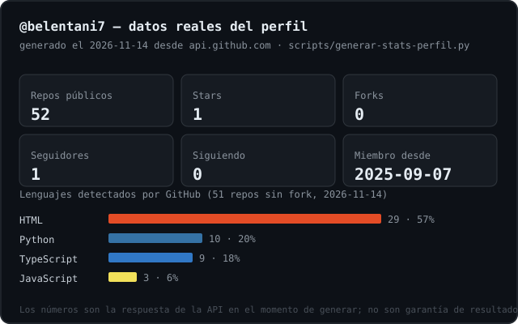

# Pedro Belentani · `belentani7`

Artist, composer and creative technologist · Staff Engineer — AI Systems

I compose music and build the digital worlds around it. My artist practice joins voice, narrative,
motion and WebGL; my engineering work spans agent systems, evaluation gates, local LLMs and MCP
tools. São Paulo · Barcelona · TypeScript · Python.




## Artist universe

**[Belentani: The Experience](https://belentani.es)** is the front door to the music and JUDAS
narrative. Its interactive galaxy lets visitors enter the lore, listen to the work and discover the
artist. The same world has two complementary tools: [Belentani Studio Motion](https://github.com/belentani7/belentani-studio-motion)
develops kinetic components, while [Belentani Visual Engine](https://github.com/belentani7/belentani-visual-engine)
explores procedural Three.js scenes from lore and code. These are distinct projects with distinct purposes.

Not every project here stands alone. [ECOSISTEMA.md](./ECOSISTEMA.md) groups the six clusters that
only make sense read together — the three entrances to Omega, the Judas canon, the router and the
registry that need each other, open education, Barcelona community work, and the inspection tools.

## Selected systems

### 01 — belentani.es
Immersive artist hub: Three.js galaxy, music catalogue and narrative universe (Judas Era in four
chapters). Public, verified.

- Repo: https://github.com/belentani7/belentani.es
- Stack: Next.js · Three.js · WebGL
- Demo: https://belentani.es (HTTP 200)

### 02 — meta-skill
Zero-token skill router for Claude Code and Qwen Code. Public, verified.

- Repo: https://github.com/belentani7/meta-skill
- Stack: Python · TypeScript · CLI
- Demo: https://meta-skill-theta.vercel.app (HTTP 200)

### 03 — secure-t
Open campus for cybersecurity and responsible AI, anonymous enrolment, automated tests. Public,
verified.

- Repo: https://github.com/belentani7/secure-t
- Stack: Next.js · TypeScript
- Demo: 398 HTML pages in the repository (git tree count, 2026-11-15)

### 04 — gpu-cost-optimizer
GPU compute cost optimizer for diffusion pipelines, up to 70% savings. Public, verified.

- Repo: https://github.com/belentani7/gpu-cost-optimizer
- Stack: Python · ComfyUI · ML
- Demo: repository with documented execution

### 05 — kepler
A galaxy of 200,000 particles in a single WebGL2 file: one draw call, no dependencies, no network
requests. Built to answer a measurable question rather than an aesthetic one.

- Repo: https://github.com/belentani7/kepler
- Stack: WebGL2 · GLSL · Vanilla JS
- Demo: https://belentani7.github.io/kepler (HTTP 200)
- Measured: 200k particles at 59.9 fps, median frame 16.7 ms, p95 17.5 ms, 0.1 ms of CPU per
  frame on an Intel UHD 620. Ceiling is 280k at a solid 60 fps; above that the p95 degrades before
  the median does.

### 06 — profile-lint
A linter for GitHub profile READMEs: dead links, missing alt text, remote assets and claims nobody
can check. Standard library only, tested on three Python versions in CI.

- Repo: https://github.com/belentani7/profile-lint
- Stack: Python · CLI · GitHub Actions
- Usage: `profile-lint README.md --root . --links`
- Measured: 85 images without alt text across 7 profile READMEs belonging to accounts with 26,000
  to 60,000 followers.

### 07 — Cruzando el charco
A multilingual, accessibility-first guide for LGTBIQ+ migrants in Barcelona and Sitges: 72 reviewed
resources and emergency phone numbers that render without JavaScript.

- Repo: https://github.com/belentani7/Cruzando-el-charco
- Stack: JavaScript · Static HTML
- Demo: https://belentani7.github.io/Cruzando-el-charco (HTTP 200)

### 08 — open-school
An open curriculum published as a static site: 5,639 HTML pages across lessons, modules and routes,
verifiable with a script that reports broken relative links and missing assets.

- Repo: https://github.com/belentani7/open-school
- Stack: HTML · Python
- Demo: https://belentani7.github.io/open-school (HTTP 200)

A system enters this list when its purpose is understandable, the public experience can be walked
through, and the repository explains how to run and verify it. Ideas, prototypes and projects without
that evidence stay out.

Private work is described but never counted as evidence: model evaluation guard, governance control
plane and a registry of 311 installable skills for 7 CLI agents live in private repositories.

## Writing & evidence

Every claim on this page links to a repository, a test or a measurement — or is labelled unverified.

- Engineering evidence: ./docs/engineering-evidence-2026-10-29.md — commit counts, review windows and
  the limits of what activity metrics measure.
- Profile archive: ./docs/profile-archive-2026-10-29.md — previous versions of this page.
- Product sheet: ./plataforma/FICHA.md — measured scope, stack and known gaps.
- Doctrine: ./BIBLIA.md — vision, mission, rules and design tokens.
- Living Machine: ./docs/living-machine/index.html — browser tools that run on repository files, with
  no upload; a local demo, not a verified live deployment.
- Proof: ./PROOF.md - what the page can prove, claim by claim, and what would falsify it.
- Ecosystem map: ./ECOSISTEMA.md — which projects only make sense connected, and the entry point of
  each, checked with curl.

Private, archived or experimental work stays out of this page.

Source and reproduction: `scripts/profile_evidence.py` runs nine machine checks and exits non-zero
on drift. The same checks run in CI on every push.

## Stack

`TypeScript` `Python` `React 19` `Next.js` `Vite` `Tailwind` `Three.js` `Node.js` `Express` `FastAPI`
`tRPC 11` `PostgreSQL` `MySQL` `Drizzle` `Docker` `GitHub Actions` `Vercel` `MCP`

No third-party stats widgets, no visitor counters, no external tracking images. One local SVG cover;
everything else is text and local links.

## Tools and experiments

Browser tools that run on the **repository files** of this repo, uploading nothing: image conversion,
subtitles, CV reading, palette extraction.

- [Living Machine — tool desktop](./docs/living-machine/index.html)
- [Studio — conversion and subtitles](./docs/living-machine/studio.html)
- [Environment diagnostics](./docs/living-machine/diagnostics.html)

This showcase is a local demo over repository files: **not a verified live deployment**. Some pieces
stay private, archived or experimental and are deliberately excluded from the public catalogue.

*Made in Barcelona · Built with AI agents · MIT/Apache-2.0 · Updated: 2026-11-16*

## Verificacion

```bash
npm install
npm test
```
