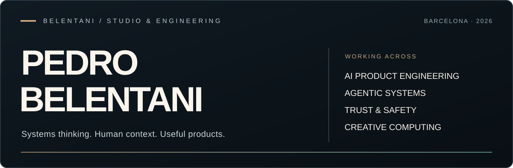

# Pedro Belentani · `belentani7`

**Senior Full-Stack AI Engineer · System Architect · Creative Technologist**
L'Hospitalet de Llobregat · Barcelona · [belentani.es](https://belentani.es)

  
  
  
  
  

  
  

> Construyo productos digitales que unen narrativa, ingeniería y dirección creativa: agentes de IA, LLMs locales, interfaces WebGL y sistemas en producción. Este perfil documenta **solo trabajo con evidencia verificable**. Cada afirmación sigue el contrato **claim → evidence → status**.

**Empieza por aquí**

| Si quieres… | Ve a |
|---|---|
| Ver sistemas que puedes ejecutar hoy | [Sistemas destacados](#sistemas-destacados) |
| Saber en qué estoy trabajando | [Último trabajo registrado](#último-trabajo-registrado) |
| Entender cómo verifico lo que afirmo | [Gobernanza operativa y evidencia](#gobernanza-operativa-y-evidencia) |
| Colaborar o contratarme | [Contacto](#contacto) |

---

## Sistemas destacados

Sistemas públicos con repositorio, ejecución documentada y estado comprobable:

| Sistema | Qué hace | Stack | Estado | Repo |
|---|---|---|---|---|
| **belentani.es** | Hub artística inmersivo: galaxia Three.js, catálogo musical y universo narrativo (Judas Era en 4 capítulos) | Next.js · Three.js · WebGL | ✅ Público · verificado | [belentani7/belentani.es](https://github.com/belentani7/belentani.es) |
| **secure-t** | Campus abierto de ciberseguridad e IA responsable, matrícula anónima, pruebas automatizadas | Next.js · TypeScript | ✅ Público · verificado | [belentani7/secure-t](https://github.com/belentani7/secure-t) |
| **ManosAbiertas** | Plataforma educativa gratuita: cursos IA/Office, creador de CV, guías de derechos para migrantes | Next.js · TypeScript · Docker | ✅ Público · verificado | [belentani7/ManosAbiertas](https://github.com/belentani7/ManosAbiertas) |
| **gpu-cost-optimizer** | Optimiza costes de compute GPU en pipelines de difusión hasta 70% | Python · ComfyUI · ML | ✅ Público · verificado | [belentani7/gpu-cost-optimizer](https://github.com/belentani7/gpu-cost-optimizer) |

Un sistema entra en esta lista cuando su propuesta se entiende, la experiencia pública se puede recorrer y el repositorio explica cómo ejecutarlo y comprobarlo. Las ideas, prototipos y proyectos sin esa evidencia quedan fuera.

---

## Último trabajo registrado

Repositorios públicos con commits más recientes. El orden es la fecha real de push, no una promesa de roadmap:

- [music-os-pedro-belentani](https://github.com/belentani7/music-os-pedro-belentani) — sistema operativo musical conceptual, Python.
- [belentani-judas-web](https://github.com/belentani7/belentani-judas-web) — capa web del universo Judas.
- [trama-trans-bcn](https://github.com/belentani7/trama-trans-bcn) — prototipo local de interés público con límites y verificación de datos.
- [tender-words-connect](https://github.com/belentani7/tender-words-connect) — mapa de comprensión sobre TLP, vínculos y regulación emocional, offline-first.

---

## Proyectos hermanos del ecosistema

Cada repositorio del ecosistema belentani7 referencia a los demás. Catálogo vivo con estado real:

- [meta-skill](https://github.com/belentani7/meta-skill) — Router de skills zero-token para Claude Code y Qwen Code
- [omniagent](https://github.com/belentani7/omniagent) — CLI para enrutar tareas IA al mejor modelo disponible
- [llm-vfx-orchestrator](https://github.com/belentani7/llm-vfx-orchestrator) — Orquestación VFX autónoma con LLMs + ComfyUI
- [Belentani.cv-ai](https://github.com/belentani7/Belentani.cv-ai) — Editor de CV, cartas de presentación, GDPR compliant, AES-256
- [heyduck](https://github.com/belentani7/heyduck) — Hub web del universo DUCK: apps, música y herramientas de producción

> Estado: cada enlace apunta a un repositorio público con README completo, licencia y CI configurados. Repos privados, archivados o experimentales se excluyen deliberadamente de este catálogo.

---

## Tecnología

  
  
  
  
  
  
  
  
  
  
  
  

Áreas de trabajo: **producto** (UI WebGL, design systems, accesibilidad) · **backend** (APIs, orquestación, colas) · **infraestructura** (Docker, CI/CD, observabilidad) · **IA aplicada** (agentes, LLMs locales, evaluación de modelos).

Forma de trabajo:

1. **Forma clara** a la idea y a la experiencia antes de escribir código.
2. **Contenido real** y límites públicos definidos; nada se afirma sin ejecución.
3. **Documentar** cómo ejecutar y verificar el producto.
4. **Publicar solo** lo que cumple ese estándar de evidencia.

---

## Gobernanza operativa y evidencia

Cada afirmación de este perfil sigue el contrato **claim → evidence → status**. Lo que no tiene evidencia se declara explícitamente como **no verificado**.

- [Evidencia de ingeniería](./docs/engineering-evidence-2026-10-29.md) — commits, recuentos y límites del trabajo registrado.
- [Archivo del perfil](./docs/profile-archive-2026-10-29.md) — historial de versiones anteriores de esta página.
- [Ficha del producto](./plataforma/FICHA.md) — alcance, stack medido, cumplimiento de reglas y brechas conocidas.
- [BIBLIA.md](./BIBLIA.md) — doctrina del producto: visión, misión, reglas y tokens de diseño.

Los números publicados describen actividad registrada en el repositorio, no una distribución de horas. Ninguna métrica de este perfil se presenta como garantía de resultado.

---

## Herramientas y experimentos

Herramientas de navegador que funcionan sobre los **repository files** de este repositorio, sin subir nada a un servidor:

- [Living Machine — escritorio de herramientas](./docs/living-machine/index.html)
- [Studio — conversión y subtítulos](./docs/living-machine/studio.html)
- [Diagnóstico del entorno](./docs/living-machine/diagnostics.html)

Este escaparate es una demostración local sobre repository files: **no es un despliegue verificado en vivo**. Algunas piezas permanecen privadas, archivadas o experimentales y se excluyen del catálogo público.

---

## Contacto

Estoy abierto a colaboraciones y a proyectos donde el problema sea difícil y el resultado tenga que demostrarse.

- **Sistemas de IA y agentes** — orquestación, evaluación, LLMs locales, tooling de agentes.
- **Arquitectura full-stack** — producto de punta a punta, de la interfaz al despliegue.
- **Tecnología creativa** — WebGL, narrativa interactiva, instalaciones.

[GitHub](https://github.com/belentani7) · [LinkedIn](https://www.linkedin.com/in/pedro-b-09473598) · [belentani.es](https://belentani.es) · Barcelona

Escríbeme si trabajas en agentes, infraestructura o IA aplicada desde Barcelona.

---

[Alcance del perfil y catálogo](./plataforma/FICHA.md). Cada producto mantiene su propio estado y documentación.

*Hecho en Barcelona · Powered by AI agents · MIT/Apache-2.0 · Actualizado: 2026-11-14*

