# PEDRO BELENTANI
**AI Systems · Product Engineering · Creative Technology**

*Barcelona metro · Brazilian perspective · ES / PT-BR / EN*

[**Professional portfolio**](https://belentani.es) · [**Living Machine**](./docs/living-machine/index.html) · [**Useful Studio**](./docs/living-machine/studio.html) · [**Projects**](#selected-work) · [**Contact**](mailto:belentani7pedro@gmail.com)

---

## A profile designed to be used, not only read

I build software and interactive experiences at the intersection of **engineering, applied artificial intelligence, human interpretation and artistic direction**.

My work spans full-stack product development, AI-agent workflows, automation, multilingual education, accessible interfaces and media-oriented tools. The common thread is not a framework: it is the ability to connect complex systems to the actual contexts of the people using them.

I approach a product through several complementary lenses.

- **Engineering:** architecture, interfaces, validation, tests, recovery paths and maintainability.
- **AI systems:** orchestration, tool use, guardrails, practical automation and human oversight.
- **Human analysis:** context, moderation, ambiguity, cultural interpretation and Trust & Safety.
- **Creative production:** visual concepts, sound, audiovisual workflows, motion and immersive interfaces.
- **Accessible communication:** clarity, language barriers, education and usable product behavior.

**My preferred outcome is a working product with honest limitations — not an impressive-looking promise that cannot be tested.**

## ◈ Living Machine / The interactive tool laboratory

The new companion experience is an **Aero-inspired browser desktop**, not a Microsoft Windows Vista installation or virtual machine. It includes multiple draggable glass windows, a taskbar, Start menu, safe narrative terminal, code rain and local-first utilities.

### Production Studio / seven working tools

**[Open the professional Studio source](./docs/living-machine/studio.html)** — a separate, responsive, modular utility workspace integrated with the original Living Machine. It uses no external runtime packages, analytics scripts, paid APIs or remote file processing.

| Studio | Implemented behavior | Limit |
|:--|:--|:--|
| **Batch image converter** | Convert up to 20 browser-readable images to JPEG, PNG or WebP and export a standards-compatible ZIP | Image decoding and encoding depend on the browser; 100 MB total input limit |
| **Subtitle time studio** | SRT/VTT time-shifting, format conversion and plain transcript export | Needs existing subtitles, not automatic speech transcription |
| **CV clarity inspector** | Local structural checks for professional communication, sections and verifiable evidence | Heuristic review, deliberately **no fictitious ATS score** |
| **Storyboard architect** | Plan editable camera shots, durations, movement, sound, export CSV or JSON | A planning utility, not a rendered video |
| **Image color sampler** | Extract approximate dominant swatches from a local image and export reusable CSS variables | Not calibrated colorimetry |
| **Image → PDF composer** | Compose A4 PDF pages from local images with JPEG metadata removal, page-fitting and margins | Requires a browser with Canvas JPEG encoding; not OCR |
| **Audio → WAV lab** | Decode compatible audio locally using Web Audio and generate 16-bit PCM WAV with waveform and gain controls | Browser codec compatibility and audio memory limits apply |

The Studio is separated into `studio.html`, `studio.css`, `studio.js`, reusable/testable `studio-core.js`, `pdf-core.js`, `audio-core.js`, and the automated `studio.test.cjs` / `media.test.cjs` suites. Its page declares a strict **no-network Content Security Policy**. All image, CV, subtitle, color and export operations are executed locally within the browser.

If you own media to be transcribed or downloaded, use its original export or an authorized source. The studio does not claim to bypass copyright, DRM, login walls or social networks' download restrictions.

### Real tools inside the machine

| Tool | Working functionality | Explicit boundary |
|:--|:--|:--|
| Image converter | PNG, JPEG, WebP and resizing through Canvas | Browser codec and memory support vary |
| Caption studio | Read and convert SRT / VTT subtitles and extract text | Not automatic transcription of uploaded video |
| Microphone dictation | Browser speech recognition where available | Speech service may process audio remotely |
| Media lab | Export video stills as PNG; record microphone audio | Local videos and supported Web APIs only |
| Data workbench | JSON formatting, CSV conversion, text slugification | Designed for conventional tabular text |
| File fingerprint | Local SHA-256 via Web Crypto | Requires supported secure browser context |
| Reel research | Export organized references and creative research notes | Not an unauthorized reel downloader |
| Private notebook | Browser-local notes and text exports | Clearing browser data also clears notes |
| Terminal | Safe read-only command simulation and Easter eggs | Does not run operating-system commands |
| Aero interface | Draggable, minimizable and maximizable windows | UI simulation, not a Windows emulator |

**[Explore the actual application code](./docs/living-machine/index.html)** — 54 KB of HTML/CSS/JavaScript focused on usable local browser capabilities rather than fake download buttons.

### Run with local repository access

~~~bash
python -m http.server 8000 --directory docs/living-machine
~~~

Open http://localhost:8000 in a modern browser. The local utility functions do not require a paid API, login or server-side file upload.

**Run the included quality checks:**

~~~bash
node --test docs/living-machine/quality.test.cjs docs/living-machine/studio.test.cjs docs/living-machine/media.test.cjs
~~~

The targeted GitHub Actions workflow is in .github/workflows/living-machine-ci.yml. Checks cover JavaScript syntax, caption round trips, ZIP structure and CRC-32, PDF cross-reference and page-tree integrity, WAV PCM format, CSV export safety, offline behavior, CV heuristics, accessibility markers and source references.

> GitHub profiles render Markdown and images, not embedded JavaScript applications. The HTML must run on a website or a local server. SVG animation may vary by GitHub client; meaningful text also remains readable when motion is unavailable.

---

## Selected work / evidence over repository volume

I am consolidating many experiments, backups and prototypes into a coherent set of canonical projects. Repository existence alone does not demonstrate a finished release, commercial adoption or audited compliance. Below are **real repositories** and what their documented scope demonstrates.

### Artificial intelligence, software engineering and safety

**[Belentani.cv-ai](https://github.com/belentani7/Belentani.cv-ai)** — A Next.js / React document studio focused on CVs and other professional outputs. Its README describes Zod input validation, rate limiting and privacy-aware flow design.

**[agentguard](https://github.com/belentani7/agentguard)** — A Trust & Safety-oriented architecture for AI agent policies, audit concepts, limits and observability. Architectural goals are deliberately distinguished from independently proven operational performance.

**[agent-skills](https://github.com/belentani7/agent-skills)** — Developer workflow skills and tooling intended to make reusable capabilities easier to discover and operate.

**[comfyui-json-compiler](https://github.com/belentani7/comfyui-json-compiler)** — Work connecting creative briefs with structured ComfyUI workflow generation and validation.

### Education, accessibility and international context

**[Open School](https://github.com/belentani7/open-school)** — An accessible educational frontend with locally stored progress, offline support and a documented optional backend. Its technical README separates working components from pending capabilities.

**[ManosAbiertas](https://github.com/belentani7/ManosAbiertas)** — Practical education: AI, office skills, CV resources and guidance for people overcoming language and digital-access barriers.

**[lingua-aberta](https://github.com/belentani7/lingua-aberta)** — Work around multilingual learning, progression and spaced repetition, informed by the difference between literal translation and real cultural interpretation.

### Creative technology and audiovisual experiences

**[The Judas Experience](https://github.com/belentani7/judas-experience-web)** — Immersive interface work with Three.js, shaders, creative direction and specification-driven development.

**[Belentani Omega](https://github.com/belentani7/belentani_Omega)** — An experimental umbrella for interactive concepts, visual systems and the artistic universe; not equivalent to a single finished commercial product.

**[Duck Studio Suite](https://github.com/belentani7/duck-studio-suite)** — Music-production related experimentation with tools and browser interfaces.

*Some repositories are private, archived or currently being consolidated. Links show source identifiers, not guaranteed public access.*

---

## Professional philosophy

### Understanding systems before building systems

My strength is often in the analytical layer before implementation: identifying the true requirement, distinguishing cause from symptom, seeing dependencies, and deciding how to keep a product understandable as its scope grows. That leads naturally to **recovery-oriented engineering, explicit state, smaller contracts and reversible changes**.

### Trust & Safety is a human-context problem

Experience in content moderation informs how I think about context, ambiguity, limits and review. AI assistance can accelerate operations, but accountability, meaningful consent, privacy and the ability to intervene remain design constraints.

### Language is a product capability

I work with **Spanish, Brazilian Portuguese and English**. Cross-cultural software needs more than translated labels. It requires attention to expectations, learning environments, trust, comprehension and different levels of digital literacy.

### Audiovisual literacy matters in engineering

Music, storytelling, motion and brand creation give me a different perspective on rhythm, attention, hierarchy and interaction. Creative tools work best when the system understands the intention of the creator and preserves meaningful control.

### Ten practical principles

1. Recover a project's original purpose before making architectural changes.
2. Do not create repositories automatically from ideas or conversations.
3. Distinguish canonical products, modules, experiments and backups.
4. Treat functioning user journeys as more important than visual promises.
5. Explain capability boundaries, external APIs and offline behavior.
6. Minimize personal-data collection and avoid hidden uploads.
7. Prefer inspectable, testable and reversible modifications.
8. Build accessible, multilingual interfaces deliberately.
9. Use automation and quality checks without eliminating human review.
10. Label implementations honestly: **working / prototype / planned / unverified**.

---

## Technology & domains

**Engineering:** TypeScript, JavaScript, React, Next.js, Node.js, Vite, Python, FastAPI, Docker, Git and CI workflows.

**AI & automation:** Agents and tool orchestration, input validation, human-in-the-loop controls, creative AI pipelines, local-model integrations and cost-conscious workflows.

**Visual computing:** Three.js, browser graphics, responsive systems, motion direction, interaction prototyping, media APIs, sound and creative-production workflows.

**Product thinking:** Accessibility, multilingual interfaces, Trust & Safety, educational technology, privacy-oriented design and practical documentation.

I also explore Go, Java and broader backend architecture. These areas are not presented as having identical levels of depth or professional production experience.

---

## En español

Soy Pedro Belentani, desarrollador de software y sistemas de IA con intereses y trabajo en análisis contextual, moderación de contenido, automatización, educación accesible y producción audiovisual.

Mi principal fortaleza es **conectar ámbitos que suelen tratarse por separado**: interpretar necesidades humanas, analizar su complejidad técnica, construir una arquitectura coherente y convertirla en una herramienta usable. Mi experiencia cultural y multilingüe influye en cómo diseño productos para personas con necesidades, contextos y conocimientos distintos.

Mi objetivo no es presentar cientos de repositorios como cientos de productos terminados, sino mostrar con claridad **qué está construido, qué funciona y qué está en investigación**.

## Em português brasileiro

Sou Pedro Belentani. Trabalho na interseção de desenvolvimento de software, sistemas de inteligência artificial, análise contextual e tecnologia criativa.

Minha abordagem combina **raciocínio técnico, sensibilidade cultural, atenção à experiência humana e direção audiovisual**. Tenho interesse especial em automação responsável, ferramentas práticas, educação acessível e experiências digitais que respeitem a intenção do usuário.

Procuro criar sistemas que possam ser compreendidos, testados e utilizados — sem confundir experimentos com produtos finalizados.

---

## Contact & collaboration

For work involving AI systems, product architecture, multilingual accessibility, useful developer tools and ambitious creative technology:

**[belentani.es](https://belentani.es)** · **[Email](mailto:belentani7pedro@gmail.com)** · **[GitHub](https://github.com/belentani7)**

© 2026 Pedro Belentani · Context before code. Human purpose before automation. Design that earns its complexity.

