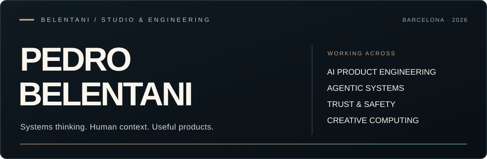

<div align="center">



# Pedro Belentani

**AI-Augmented Product Engineering · Agentic Systems · Trust & Safety · Creative Technology**

*Independent builder · Brazilian perspective, Barcelona area · Português / Español / English / Català*

[**Portfolio**](https://belentani.es) · [**Software atlas**](https://github.com/belentani7/belentani-omg-portal) · [**Selected work**](#selected-work) · [**Engineering evidence**](#engineering-evidence) · [**Contact**](#contact)

</div>

---

## Engineering informed by human context

I design and build digital products at the intersection of **full-stack engineering, applied AI, operational safety and creative direction**. My work connects product research, accessible interfaces, APIs, agentic workflows, verification and documentation.

Before building software independently, I worked in **multilingual customer operations and content moderation / Trust & Safety**. That experience shapes how I approach ambiguous requirements, international users, risk, policy constraints and recovery from failure.

I work as an **AI-augmented multidisciplinary individual contributor**: defining scope, choosing technology, implementing, testing and refining products while keeping accountability and human judgment in the loop. The goal is useful, inspectable work—not volume for its own sake.

## Selected work

These six publicly accessible, unarchived repositories represent distinct areas of my work. The list is curated by product relevance and technical breadth, not GitHub stars or repository count. Features, tests and publication status should be checked in the corresponding source.

| Product | What it demonstrates |
| --- | --- |
| **[Belentani CV Studio](https://github.com/belentani7/Belentani.cv-ai)** | React / Next.js document tooling, accessible editing, local drafts, consent-aware AI options, validation and private API safeguards. |
| **[Manos Abiertas](https://github.com/belentani7/ManosAbiertas)** | Free practical education for people navigating digital and language barriers: courses, career tools, multilingual learning and accessible user journeys. |
| **[Secure-T](https://github.com/belentani7/secure-t)** | An open cybersecurity and AI learning campus, with structured curricula, browser-based practice, offline-first considerations and regression tests. |
| **[LinguaForge](https://github.com/belentani7/linguaforge)** | Language education architecture using CEFR/MCER progression, spaced repetition, multilingual routes and documented content provenance. |
| **[BELENTANI / Artist Experience](https://github.com/belentani7/belentani.es)** | Creative direction and engineering for an original music universe: a Three.js galaxy, interactive narrative chapters and browser-verified visual journeys documented in source. |
| **[BELENTANI Software Atlas](https://github.com/belentani7/belentani-omg-portal)** | A navigation layer organizing product families, source references, repository discovery and project status without conflating experiments with releases. |

**Creative technology:** Alongside software, I develop original music, visual identities and interactive narrative experiences. This work informs my approach to typography, motion, storytelling and experiential UI. Explore the wider [BELENTANI portfolio](https://belentani.es).

## Capabilities

| Product engineering | Applied AI & operations | Experience & creative computing |
| --- | --- | --- |
| React, Next.js, TypeScript, JavaScript | Agent workflows, model/tool orchestration | Interface systems, design direction |
| Python, FastAPI, Node.js, SQL | Human review, safety boundaries, evaluation | Three.js, WebGL, browser media APIs |
| Git, GitHub Actions, Docker, CI/CD | Privacy-aware flows, validation, automation | Accessible UX, multilingual content |
| API contracts, testing, deployment gates | Trust & Safety, incident and policy context | Educational and audiovisual products |

**Approach:** Understand the problem → map the user journey → define a bounded system → implement → test real paths → document limitations → publish only with evidence.

## Experience behind the code

**2026–present · Independent product builder & creative technologist — BELENTANI / NOIACORE.** Building and refining applied-AI, education, developer-tooling and creative-web projects. This is independent product work, not a claim of past enterprise engineering employment.

**2018–2025 · Community management, content moderation & Trust & Safety.** Work with specialist digital-operations providers, including experience referenced in professional CV documentation for TELUS / CCC. Applied policy interpretation, contextual review, escalation and multicultural coordination.

**2016–2018 · Multilingual customer support.** Customer operations through Sellbytel / Webhelp for Inditex group retail brands, dealing with purchases, after-sales questions and exceptions across Portuguese, Spanish and English.

**Languages:** Portuguese (native), Spanish (fluent), Catalan (professional), English (professional use; documented B2 certificate). My experience with language and cultural context informs product design beyond simple translation.

## Engineering evidence

The strongest signal is not a large repository count; it is the **specific problems addressed and the changes available for inspection**.

- **Privacy and product UX:** [private, accessible CV review](https://github.com/belentani7/Belentani.cv-ai/commit/258f0b3ff0ca40dcaf8f86bc537b48b6127b05e9) and [security header regression tests](https://github.com/belentani7/Belentani.cv-ai/commit/b1f67fdc7939dc26352bf75958da404a11aa5a61).
- **Education and accessibility:** [accessible workshops](https://github.com/belentani7/ManosAbiertas/commit/8b97cd83223d494f13c87caed1b5e9ed0df1eede) and [browser journey checks](https://github.com/belentani7/ManosAbiertas/commit/b55ace590912cec8bc92f6e9e412283df48cfc32).
- **Secure learning experience:** [institutional language and browser journeys](https://github.com/belentani7/secure-t/commit/45b07bf045e59f01efc931f2cf934110fdeb90e3).
- **Engineering operations:** [measured observability and bounded recovery](https://github.com/belentani7/belentani7/commit/c2c21b608bc57fe7070d99aad4f6f59f4d5ac59c).

**[Read the commit evidence and methodology](./docs/engineering-evidence-2026-10-29.md).** A bounded review covered 110 recent GitHub commit entries across four public repositories. It examines chronology, feature work, tests, security and interface changes. Git timestamps **cannot** reliably measure human hours or prove deployment success, and the sample is not a count of all personal contributions.

## Working principles

- **Product integrity:** a beautiful interface must serve a complete and understandable user journey.
- **Verification:** use tests, source references and actual deployment checks; distinguish planned functionality from verified behavior.
- **Accessibility and language:** support real reading, keyboard, mobile and international user needs.
- **Safety and privacy:** handle consent, sensitive data, failure paths and automation boundaries deliberately.
- **Craft and clarity:** cohesive design systems, readable code, maintainable documentation and reversible changes.

My repositories include active products, research prototypes and archived experiments. **Repository existence is not a claim of an audited, deployed or commercially adopted product.**

## Explore further

**[Software atlas](https://github.com/belentani7/belentani-omg-portal)** — a starting point for the broader code ecosystem, experiments and canonical project families.

**[Living Machine source](./docs/living-machine/index.html)** · **[Browser Studio source](./docs/living-machine/studio.html)** — local-first media and productivity utilities including image conversion, subtitle timing, CV clarity review, storyboard planning and document/audio tooling. These repository file links are **source links**, not proof of a public interactive deployment. To run them locally:

```bash
python -m http.server 8000 --directory docs/living-machine
# Open http://localhost:8000/
```

**[Detailed historical profile (archive)](./docs/profile-archive-2026-10-29.md)** — preserved content and past technical descriptions; the root README is the current editorial entry point.

## Contact

For product engineering, applied AI, accessible educational tools, workflow automation, Trust & Safety and creative computing:

[**belentani.es**](https://belentani.es) · [**GitHub**](https://github.com/belentani7) · [**Email**](mailto:belentani7pedro@gmail.com)

<sub>© 2026 Pedro Belentani · Systems thinking. Human context. Useful products.</sub>
