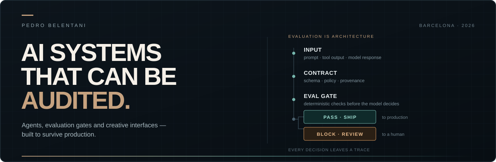

  

# Pedro Belentani

### AI systems with the safety rails built in.

Most agent projects stop at the demo. I build the rest: contracts, evaluation gates, audit trails and cost controls — then the interface that makes them usable.

Barcelona. Open to senior AI engineering roles and selected collaborations.

| If you want to… | Read |
| :-- | :-- |
| See what actually runs today | [Selected systems](#selected-systems) |
| Check how I verify a claim | [Writing & evidence](#writing--evidence) |
| Know what working together looks like | [How I work](#how-i-work) |
| Start a conversation | [Contact](#contact) |

---

## Selected systems

Three systems that show the range: model evaluation, engineering governance, and developer tooling. All three repositories are private: they are described here, and opened on request.

### 01 — NoiaCore Model Guard

Evaluation gate that blocks unsafe model input and output before it becomes a production decision. Contracts, secret-leakage checks, drift signals and a `ready / review / not_ready` envelope.

`React 19` · `tRPC 11` · `Drizzle` · `MySQL` · Private, available on request — `https://github.com/belentani7/noiacore-model-guard`

### 02 — FORJA

Governance control plane for AI-assisted engineering: organisation isolation, RBAC, SHA-256/Ed25519 audit ledger and per-agent limits. Verified with 25 tests across 10 files.

`React 19` · `Express` · `tRPC` · `Drizzle` · Private, available on request — `https://github.com/belentani7/forja-enterprise`

### 03 — Agent Skills

311 installable skills for 7 CLI agents (Claude Code, Codex, OpenCode, Cline, Qwen, Gemini, ZCode), behind one registry and one installer.

`Python` · `PowerShell` · `Bash` · Private, available on request — `https://github.com/belentani7/agent-skills`

**Evidence → status.** Every claim here is tied to a repository, a test or a measurement — or it is labelled unverified. The label is part of the product, not a disclaimer.

## Also in the open

Public, and one click away:

- **[secure-t](https://github.com/belentani7/secure-t)** — open school for cybersecurity, responsible AI and governance. 28 pages, no signup, no paywall.
- **[trama-trans-bcn](https://github.com/belentani7/trama-trans-bcn)** — public-interest prototype that shows where its data comes from and how it is verified.
- **[belentani-portfolio](https://github.com/belentani7/belentani-portfolio)** — the system behind [belentani.es](https://belentani.es): music, narrative and AI lab in one platform.

## How I work

1. **Contract before code.** If the failure mode is not written down, it is not designed.
2. **Evidence over adjectives.** Every claim links to a repo, a test or a measurement — or it is labelled unverified.
3. **Deterministic before probabilistic.** Rules and schemas first; the model is the last mile, not the foundation.
4. **Ship the interface.** A system nobody can operate is not finished.

What that means for a collaboration: you get the failure modes and the verification path in the first week, and a demo only once both hold. If a deadline forces a claim I cannot test, I would rather cut the claim.

## Stack

`TypeScript` `Python` `React 19` `Next.js` `Vite` `Tailwind` `Three.js` `Node.js` `Express` `FastAPI` `tRPC 11` `PostgreSQL` `MySQL` `Drizzle` `Docker` `GitHub Actions` `Vercel` `Ollama` `MCP`

Product interfaces (React, Next.js, Three.js, Tailwind) · services and data (Node.js, Express, FastAPI, tRPC, PostgreSQL, MySQL, Drizzle) · AI layer (local models through Ollama, MCP tooling, agent evaluation).

## Writing & evidence

Anything here that is not backed by a repo, a test or a measurement is labelled unverified. Private, archived or experimental work stays out of this page.

- [Engineering evidence](./docs/engineering-evidence-2026-10-29.md) — commits, counts and the limits of what is measured.
- [Profile archive](./docs/profile-archive-2026-10-29.md) — previous versions of this page.
- [Living Machine](./docs/living-machine/index.html) — browser tools that run on repository files, with no upload: a local demo, not a verified live deployment.
- [Product sheet](./plataforma/FICHA.md) — scope, measured stack and known gaps.
- [Doctrine](./BIBLIA.md) — vision, mission, rules and design tokens.

The numbers in the evidence file describe activity recorded in the repositories, not a distribution of hours. No metric on this page is a guarantee of outcome.

## Contact

[Website](https://belentani.es) · [LinkedIn](https://www.linkedin.com/in/pedro-b-09473598/) · [Email](mailto:belentani7studio@proton.me) · Barcelona

The fastest way to start: send the problem and the failure mode that keeps you awake. I answer with a scope, the evidence I would produce, and what I would not promise.

---

Barcelona · AI infrastructure, evaluation and trust &amp; safety · Updated: 2026-11
