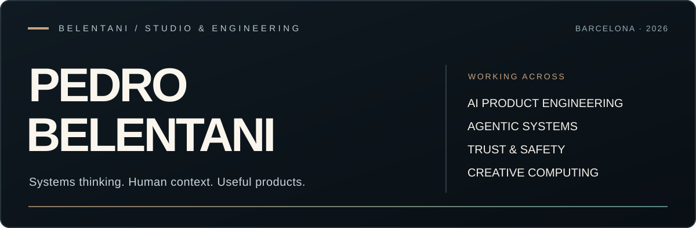

# PEDRO BELENTANI

### Senior Full-Stack AI Engineer · Systems Architect · Creative Technologist

**Engineering × Art × Intelligent Systems**

Barcelona, Spain

[Portfolio & creative engineering](https://github.com/belentani7/belentani.es) · [Repositories](https://github.com/belentani7?tab=repositories)

---

## Architecting intelligent systems. Crafting immersive experiences.

I build AI systems, developer tools and immersive digital experiences, connecting
systems architecture with clear interfaces and human context.

My practice spans **AI orchestration, full-stack engineering, Trust & Safety and
creative technology**. My background in content moderation and community operations
informs how I approach human review, accountable automation and product design.
As **BELENTANI**, I also explore music, interactive storytelling and real-time visuals.

## Featured systems

| System | Engineering focus | Source & validation |
| :--- | :--- | :--- |
| **Meta-Skill** | Offline task routing, explainable decisions, abstention and reproducible evaluation. | [Repository](https://github.com/belentani7/meta-skill) · [CI](https://github.com/belentani7/meta-skill/actions) |
| **BELENTANI — The Experience** | Creative web, full-stack interfaces and interactive storytelling. | [Repository](https://github.com/belentani7/belentani.es) |
| **Secure-T** | Cybersecurity education and accessible learning technology. | [Repository](https://github.com/belentani7/secure-t) |
| **LLM VFX Orchestrator** | Shot planning, continuity prompts and local production manifests. | [Repository](https://github.com/belentani7/llm-vfx-orchestrator) |

These links identify source projects. Each repository's checks and release history
provide its implementation status; a source link alone does not establish a working deployment.

## Capability atlas

| Discipline | Focus |
| :--- | :--- |
| **AI systems** | Task routing, agent workflows, local model integration, evaluation and CLI automation. |
| **Full-stack architecture** | Python, FastAPI, TypeScript, React, Next.js, Node.js, PostgreSQL and APIs. |
| **Creative technology** | Three.js, WebGL, real-time rendering, accessible interaction and motion design. |
| **Trust & Safety** | Content operations, human review, privacy and accountable automation. |

## Tools and experiments

**[Living Machine](docs/living-machine/index.html)** brings browser utilities,
media tools and diagnostics into an inspectable, dependency-free experiment.
The tools remain inspectable in the repository files. This page is not a verified live deployment;
private, archived or experimental work is not presented as production-ready.
Its [functional suite](docs/living-machine/quality.test.cjs) lives beside its source.

## Working principles

- **Architecture with purpose.** Define boundaries, failure modes and recovery paths.
- **Intentional interfaces.** Make interaction accessible, readable and responsive.
- **Portable systems.** Prefer inspectable tools and deliberate service dependencies.
- **Measured delivery.** Validate behavior and document the limits of each release.

## Evidence & operational governance

The portfolio uses **claim → evidence → status**: source, tests, build artifacts and
production availability are separate checks. Evidence that has not been executed
or refreshed is **not verified**.

[Engineering evaluation](./docs/engineering-evidence-2026-10-29.md) ·
[Profile history](./docs/profile-archive-2026-10-29.md) ·
[Product specification](plataforma/FICHA.md) ·
[Local validation](./docs/profile-repair-2026-11-11.md)

## Technology

`Python` · `TypeScript` · `JavaScript` · `React` · `Next.js` · `Node.js` ·
`FastAPI` · `PostgreSQL` · `Docker` · `Three.js` · `WebGL` · `GitHub Actions`

## En español

Soy Pedro Belentani, artista y tecnólogo creativo en Barcelona. Desarrollo sistemas
de IA, herramientas y experiencias digitales, combinando arquitectura de software,
diseño de interacción y experiencia en Trust & Safety.

---

**Build systems that work. Create experiences that matter.**

[Explore the code](https://github.com/belentani7?tab=repositories)
